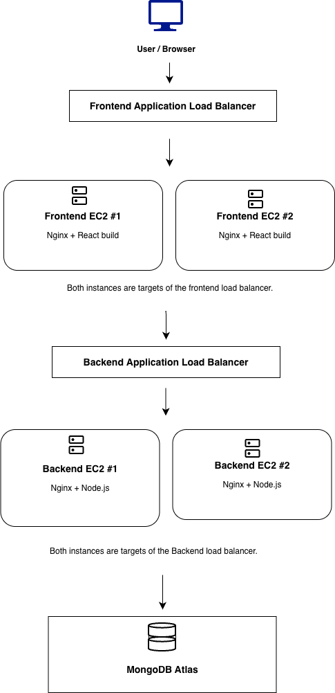

# TravelMemory — AWS Cloud Deployment

## Project Overview

This project demonstrates the deployment of the TravelMemory MERN application on Amazon Web Services (AWS).

The application consists of a React frontend, a Node.js and Express backend, and MongoDB Atlas for database storage. The deployment uses Amazon EC2, Nginx, Application Load Balancers, and MongoDB Atlas.

## Source Application

[TravelMemory — GitHub](https://github.com/UnpredictablePrashant/TravelMemory)

## Deployed Architecture

The React frontend is served through the frontend Application Load Balancer. API requests are routed through the backend Application Load Balancer to the Node.js backend instances, which connect to MongoDB Atlas.



## Deployment Environment

| Component | Configuration |
|---|---|
| Cloud provider | Amazon Web Services |
| AWS Region | Asia Pacific (Mumbai) — `ap-south-1` |
| Operating system | Ubuntu 24.04 LTS |
| Frontend | React.js |
| Web server | Nginx |
| Backend | Node.js and Express |
| Process management | systemd |
| Database | MongoDB Atlas |
| Load balancing | Application Load Balancer |
| Compute | Amazon EC2 |

## Deployment Evidence

Screenshots documenting the deployed application, AWS infrastructure,
load balancers, target group health, and verification results are available
in [`docs/screenshots/`](docs/screenshots/).

See the [Deployment Guide](docs/deployment-guide.md) and
[AWS Architecture Diagram](docs/TravelMemory-AWS-Architecture.drawio.png)
for additional details.

## Repository Structure

```text
TravelMemory-AWS-Deployment/
├── README.md
├── deployment/
│   ├── nginx/
│   └── systemd/
├── docs/
│   ├── deployment-guide.md
│   ├── architecture.drawio
│   ├── TravelMemory-AWS-Architecture.drawio.png
│   └── screenshots/
└── TravelMemory/
    └── Original application source
```

## Verification

The following acceptance tests were completed:

- [x] Frontend loads through the frontend ALB.
- [x] Existing trips are retrieved successfully.
- [x] Backend `/health` endpoint confirms database connectivity.
- [x] Backend `/hello` endpoint responds successfully.
- [x] New trips can be created through the application UI.
- [x] Newly created trips appear after refreshing the homepage.
- [x] Both frontend target instances report healthy status.
- [x] Both backend target instances report healthy status.

## Documentation and Evidence

- [Deployment Guide](docs/deployment-guide.md)
- [AWS Architecture Diagram — Draw.io](docs/architecture.drawio)
- [AWS Architecture Diagram — PNG](docs/TravelMemory-AWS-Architecture.drawio.png)
- [Deployment Screenshots](docs/screenshots/)

## Security

- Do not commit database credentials, `.env` files, AWS access keys, private SSH keys, or other secrets.
- Keep database credentials in server-side environment files.
- Restrict SSH access to trusted administrative IP addresses.
- Configure security groups to allow only required traffic.
- Do not expose sensitive credentials in screenshots or documentation.

## Cost Management and Cleanup

Review AWS billing and resource usage after completing the assignment.

Resources that may incur charges include EC2 instances, EBS volumes and snapshots, Application Load Balancers, public IPv4 addresses, and data transfer.

Stop or remove resources that are no longer required, while retaining any resources needed for evaluation or demonstration.
